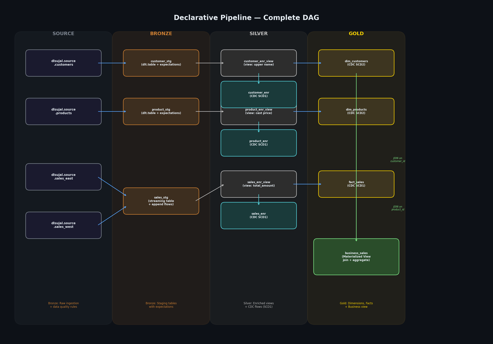

# Declarative Pipeline — Data Engineering Project

A multi-stage **Lakeflow Spark Declarative Pipeline (SDP)** built on Databricks, implementing a Medallion Architecture (Bronze → Silver → Gold) for sales analytics. The pipeline ingests raw source data, applies transformations and data quality rules, tracks Change Data Capture (CDC) with SCD Type 1 and Type 2, and produces dimensional tables and a business-ready aggregated view.



---

## Architecture Overview

The pipeline follows a **Medallion Architecture** with three layers:

| Layer | Purpose | Techniques |
|---|---|---|
| **Bronze** | Raw data ingestion from source tables | `dlt.table`, `readStream`, data quality expectations |
| **Silver** | Cleansing, enrichment, and CDC tracking | `dlt.view`, `create_streaming_table`, `create_auto_cdc_flow` (SCD1) |
| **Gold** | Dimensional modeling and business analytics | `create_streaming_table`, `create_auto_cdc_flow` (SCD1 & SCD2), materialized views |

### Source Tables (Unity Catalog: `dlsujal.source`)

| Table | Columns |
|---|---|
| `customers` | `customer_id`, `customer_name`, `region`, `last_updated` |
| `products` | `product_id`, `product_name`, `category`, `price`, `last_updated` |
| `sales_east` | `sales_id`, `customer_id`, `product_id`, `quantity`, `amount`, `sale_timestamp` |
| `sales_west` | `sales_id`, `customer_id`, `product_id`, `quantity`, `amount`, `sale_timestamp` |

---

## Stage-by-Stage Explanation

### 1. Bronze Layer — Raw Ingestion

**Location:** `DLT Root/transformations_source_code/Tutorial/Bronze/`

This layer ingests raw data from Unity Catalog source tables using Auto Loader streaming reads, with data quality expectations that drop invalid rows.

| File | Dataset | Description |
|---|---|---|
| `ingestion_customer.py` | `customer_stg` | Streams `dlsujal.source.customers` with `@dlt.expect_all_or_drop` rules: `customer_id IS NOT NULL`, `customer_name IS NOT NULL` |
| `ingestion_products.py` | `product_stg` | Streams `dlsujal.source.products` with expectations: `product_id IS NOT NULL`, `price >= 0` |
| `Insection_source_sales.py` | `sales_stg` | Streams `dlsujal.source.sales_east` and `dlsujal.source.sales_west` using `@dlt.append_flow` (multi-source ingestion). Expectation: `sales_id IS NOT NULL` |

### 2. Silver Layer — Transformation & Enrichment

**Location:** `DLT Root/transformations_source_code/Tutorial/Silver/`

This layer transforms the raw Bronze data through views and writes enriched data to streaming tables using **Auto CDC flows** with **SCD Type 1** (overwrite on update, no history tracking).

| File | View | Streaming Table | Transformations |
|---|---|---|---|
| `TransformCustomer.py` | `customer_enr_view` | `customer_enr` | Uppercase `customer_name`; CDC key: `customer_id`, sequence: `last_updated` |
| `Transform_product.py` | `product_enr_view` | `product_enr` | Cast `price` to IntegerType; CDC key: `product_id`, sequence: `last_updated` |
| `Transform_sales.py` | `sales_enr_view` | `sales_enr` | Add `total_amount = quantity × amount`; CDC key: `sales_id`, sequence: `sale_timestamp` |

### 3. Gold Layer — Dimensional Modeling & Analytics

**Location:** `DLT Root/transformations_source_code/Tutorial/Gold/`

This layer creates dimension and fact tables using Auto CDC flows, and a final business view that joins everything together.

| File | Dataset | SCD Type | Description |
|---|---|---|---|
| `Dim_customers.py` | `dim_customers` | **SCD Type 2** | Tracks full history of customer changes. CDC key: `customer_id`, sequence: `last_updated`. Adds `__START_AT` / `__END_AT` validity columns |
| `Dim_product.py` | `dim_products` | **SCD Type 2** | Tracks full history of product changes. CDC key: `product_id`, sequence: `last_updated` |
| `Fact_sales.py` | `fact_sales` | **SCD Type 1** | Overwrites on update (no history). CDC key: `sales_id`, sequence: `sale_timestamp` |
| `Business_sales.py` | `business_sales` | N/A | Materialized view that joins `fact_sales` → `dim_customers` (on `customer_id`) → `dim_products` (on `product_id`), then aggregates `total_amount` by `region` and `category` as `Total_sales` |

### Basic Layer — Learning Exercises

**Location:** `DLT Root/transformations_source_code/Tutorial/Basic/`

| File | Description |
|---|---|
| `1_corecomponent.py` | Examples of `@dlt.table` (streaming & materialized) and `@dlt.view` (batch & streaming) |
| `2_dependency.py` | End-to-end pipeline example: staging → transformed → aggregated |

---

## Data Flow

```
dlsujal.source.customers ──▶ customer_stg ──▶ customer_enr_view ──▶ customer_enr ──▶ dim_customers (SCD2)
                                                                              │
dlsujal.source.products  ──▶ product_stg  ──▶ product_enr_view  ──▶ product_enr  ──▶ dim_products (SCD2)
                                                                              │      ┌───────────┐
dlsujal.source.sales_east ┐                                                   │      │  business  │
dlsujal.source.sales_west ┘──▶ sales_stg   ──▶ sales_enr_view   ──▶ sales_enr  ──▶ fact_sales (SCD1)──▶│  _sales   │
                                                                              │      └───────────┘
                                                                   join on customer_id + product_id
                                                                   group by region, category
                                                                   sum(total_amount) as Total_sales
```

### `business_sales` Output

| region | category | Total_sales |
|---|---|---|
| East | Electronics | 3020.00 |
| East | Furniture | 2750.00 |
| West | Electronics | 1320.00 |
| West | Furniture | 650.00 |
| West | Stationery | 2240.00 |

---

## Project Structure

```
Declerative-Pipeline-DE/
├── README.md
├── pipeline_dag.png
├── DWH SOURCE.dbquery.ipynb
├── source_order.dbquery.ipynb
└── DLT Root/
    └── transformations_source_code/
        └── Tutorial/
            ├── Basic/
            │   ├── 1_corecomponent.py
            │   └── 2_dependency.py
            ├── Bronze/
            │   ├── ingestion_customer.py
            │   ├── ingestion_products.py
            │   └── Insection_source_sales.py
            ├── Silver/
            │   ├── TransformCustomer.py
            │   ├── Transform_product.py
            │   └── Transform_sales.py
            └── Gold/
                ├── Dim_customers.py
                ├── Dim_product.py
                ├── Fact_sales.py
                └── Business_sales.py
```

---

## Key Concepts Used

* **Streaming Tables** (`dlt.create_streaming_table`) — Append-only tables for streaming ingestion
* **Auto CDC Flows** (`create_auto_cdc_flow`) — Change Data Capture with SCD Type 1 and Type 2
* **Data Quality Expectations** (`@dlt.expect_all_or_drop`) — Drop rows that fail validation rules
* **Multi-Source Ingestion** (`@dlt.append_flow`) — Ingest from multiple sources into a single streaming table
* **Materialized Views** (`@dlt.table` with batch reads) — Periodically refreshed views for analytics
* **Streaming Views** (`@dlt.view` with `readStream`) — Real-time transformation views

---

## How to Run

1. Ensure the source tables exist in Unity Catalog (`dlsujal.source` schema)
2. Create a Lakeflow Spark Declarative Pipeline in Databricks
3. Add all Python files from the `Bronze/`, `Silver/`, and `Gold/` folders as source code
4. Configure the pipeline to publish to `dlsujal.dltschema` schema
5. Run a **Full Refresh** to materialize all tables
6. Query the `business_sales` table for final aggregated results

---

## Technologies

* **Databricks** — Cloud data platform
* **Lakeflow Spark Declarative Pipelines (SDP)** — Declarative data pipeline framework
* **PySpark** — Distributed data processing
* **Unity Catalog** — Data governance and table management
* **Auto CDC** — Change Data Capture with SCD1/SCD2 tracking
